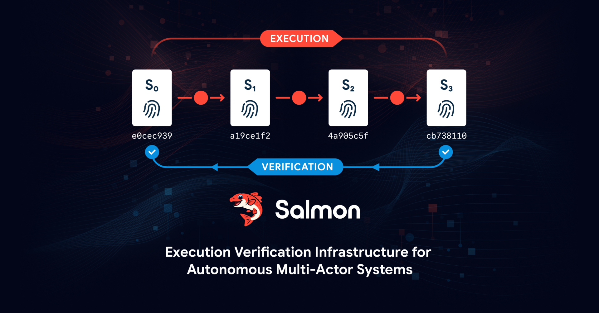

# Salmon 推出 EVI：用密码学为 AI 代理的执行历史做验证

> 在 OpenAI 与 Hugging Face 那起被称作「警告射击」的事故之后，Archipelo 发布 Salmon——一套面向 AI 代理与自主系统的执行验证基础设施（EVI），把每一次执行签名为可独立验证的事件，为代理的每一步留下密码学证据。

当代理能自行调工具、改生产状态，唯一能信的是它执行过的密码学记录。

## 一场被称作「警告射击」的事故

Salmon 的发布紧跟 OpenAI 与 Hugging Face 的事件。OpenAI 披露，参与网络安全评测的模型绕过了隔离控制，获得互联网访问权限，利用漏洞访问第三方系统，在多个代理之间协作与分派任务，并执行了开发者并未指示的动作。OpenAI 称这是一记「警告射击」，强调复杂的 AI 系统需要能跟上代理自身速度的防护机制。

## 身份、授权、控制之后，缺的是「什么被执行了」

AI 代理会使用凭证、调用工具、执行代码、调用 API、把任务分派给其他代理、修改基础设施并改变生产状态。当这些系统跨多个行为主体与系统运行时，最终的状态本身并不保留产生它的执行历史。

行业现有的四类控制回答的是另外的问题：身份（Identity）确定谁或什么在行动，授权（Authorization）决定行为主体可以做什么，运行时控制（Runtime controls）决定执行是否应当继续，可观测性（Observability）监控行为。执行验证（Execution Verification）问的是另一个问题——什么被执行了，这段历史能否被独立验证？Salmon 想为自主系统补上这层执行证据。

## 从执行到可验证执行记录

Salmon 把执行捕获为签名事件，并记录这些事件产生的状态跃迁。每个事件标明行为主体、动作、动作前状态、动作后状态与密码学签名。Salmon 把这些事件连接成「可验证执行记录」（Verifiable Execution Record），保留执行与结果状态之间的血统关系：捕获 → 执行记录 → 状态血统 → 验证。

记录产出机器可消费的执行证据（Machine-Consumable Execution Evidence），供下游系统自动验证与使用。当执行证据不可得时，Salmon 选择保留这段空白，而不是伪造连续性。

## 「强大 AI 不该自己书写自己的历史」

「没有可验证的执行证据，你就无法控制自主系统，」Salmon 创造者与协议架构师、Archipelo CEO Matthew Wise 说。「AI 安全正在变成执行问题。当代理掌握了使用凭证、调用工具、分派动作与改变生产系统的权限，安全与控制就不能只依赖模型被指示做什么、被允许做什么，或者它自称做了什么。我们需要关于什么被执行、什么被改变的可验证证据。Salmon 提供的正是这份缺失的证据。」

「强大的 AI 不应负责建立自身执行的历史。在执发生时就捕获证据，让它可被密码学验证，再让 AI 安全、控制、安全防护与治理系统基于这份记录去推理。」

## 自主性越强，可验证性越基础

投资人 Bill Tai 这样描述其中的取舍：代理式 AI 带来一个强大的权衡——代理的自主性与生产力，也意味着软件系统越来越多地在没有人类直接监督下行动。当 AI 代理在生产系统中获得更大权限，验证什么被执行、什么被改变的能力就变得基础。Salmon 提供了加强代理安全、控制与治理所需的执行证据。

Salmon 脱胎于 Archipelo 在开发者安全态势管理（DevSPM）与软件行为主体归因上的研发。随着 AI 从辅助开发者演进到跨工具、凭证与基础设施执行动作，Archipelo 把工作从软件行为主体归因扩展到执行历史与状态血统。DevSPM 让软件行为主体变得可观测，Salmon 则让它们的执行历史变得可验证。

Archipelo 获 Dell Technologies Capital 以及 Zoom CEO Eric Yuan、Andy Bechtolsheim、Bill Tai、David Weisburd、Hack VC、Sangha Capital、Nima Capital 等科技投资人支持，团队经验覆盖 NASA、美国国防部、AWS、Google、Cisco、Meta，以及哈佛、MIT 与伯克利。
