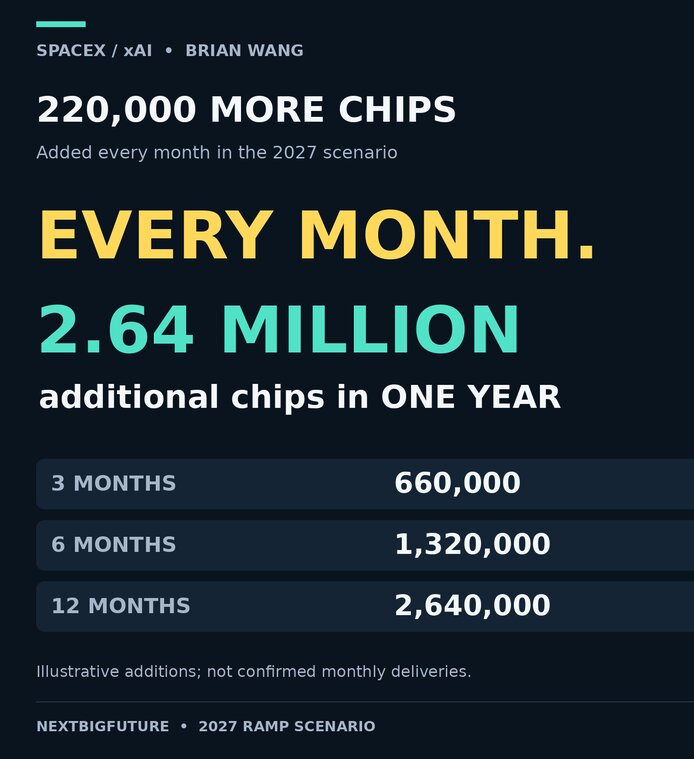

# SpaceX 每月新增50万千瓦算力 年底前建成五座巨型AI数据中心

> 马斯克确认，SpaceX 正以每座450兆瓦（约50万千瓦）为单位串行建造AI数据中心，四座同时开工、一个月交付一座，到2026年底将建成五座巨型机房，年底年化租金收入有望冲到1300亿至1400亿美元。

SpaceX 把「应急兆瓦」做成了流水线：四座并行，一个月出货一座。

## 一个月交付一座，四座同时开工

SpaceX 到2026年底将建成五座巨型AI数据中心。这些机房以450兆瓦为单元串行生产，从动工到芯片装机完成只需四个月；同一时间四座并行推进，最终压出「一个月交付一座」的节奏。这个速度将延续到2027年，届时芯片会切换到 Rubin 架构。马斯克把这称作彻底的统治，并预告到12月底钱还会更多。

## Colossus 1 与等着通电的百万张 B300

现有算力盘点如下：Colossus 1 装了15万张 H100、5万张 H200 和3万张 GB200，合计约23万张卡。马斯克9月25日在X上表示，又有22万张 GB300 下周全面投入运行，11月再上22万张，若运气好，12月底还能再来22万张。NextBigFuture 标注，前两批分别对应代号 Macrohardr（即 Colossus 2）与 minihard。

> "Another 220k GB300 will be fully operational next week and another 220k in November. If we get lucky, yet another 220k GB300 by late December."
>
> —— Elon Musk，2026年9月25日

## 密西西比第五座，连名字都还没有

早在7月，作者就判断 SpaceX 能为AI数据中心装齐2.5吉瓦电力。照现在的进度，Colossus 2 与 Macrohardr 下周即可运行，minihard 11月上线，第四座尚未命名的建筑连同全部芯片将在12月到位。Colossus 1 的23万张卡每年租金约70亿美元；而 Colossus 2、Macrohardr、minihard 加第四座建筑合计约121万张卡，绝大多数是 B300，租金能力远高于前者。

9月初，密西西比州 Southaven 批准了第五座数据中心：66万平方英尺，坐落在 Tulane 路原市警察与消防训练场（51英亩，近8425 Tulane Road），紧邻 SpaceXAI 位于 Stanton 路的发电厂。它还没有马斯克式的绰号，但马斯克说，这座建筑的电力和芯片都会在四个月内完工——快过它获得名字的速度。

## 年底1300亿、明年底5000亿美元的年化租金

年底前，SpaceX 预计还能新增110亿至250亿美元的年度经常性租金收入（ARR）。无论走自有AI变现还是对外出租，2027年全年都能按每月250亿美元的速度推进：2026年底 ARR 达1300亿至1400亿美元，2027年底在第四季度的加速节奏下冲到5000亿美元。而他们完全可能再次提速。

按作者的牛市剧本，SpaceX 此刻已提前一个月，约3吉瓦能源配齐全部芯片。若继续每月22万张卡、450兆瓦的节奏，到2027年底还能再装约6吉瓦，总装机将达到9吉瓦。单是 Minihard 一处，建成并装入22万张 B300（450兆瓦）耗时五个月，每年可租出250亿美元。今年最后三个月，他们每月激活500兆瓦的芯片，其中约10%的折减（降至450兆瓦）来自更密集机房的能效优化。
