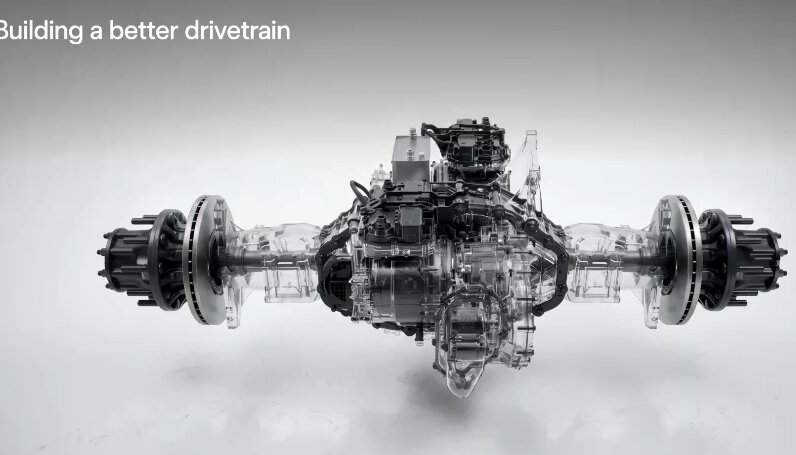

# Dan Priestly 与 Lars 主导 Tesla Semi 活动 产线全自动、Megacharger 提速

> Tesla Semi 活动由 Dan Priestly 与 Lars 领衔，现场展示了电池电芯的全自动卸载与装车；自动驾驶功能即将加入，30多座 Megacharger 充电站与200多个兆瓦级充电桩正在铺开，司机休息30分钟就能补回最多60%续航。

电芯全自动下线装车，Tesla Semi 把「油换电」的账算到了每英里。

## 电芯全自动装车，自动驾驶紧随其后

Tesla Semi 官方账号9月25日披露，电池电芯的卸载与装车已经实现全自动化，整条产线不再需要人工介入这一环节。官方同时预告，自动驾驶功能「很快就会加入」。这场活动由 Dan Priestly 与 Lars 主导，把 Semi 的量产化进展摆到了台前。

## 30分钟补60%续航的充电网络

配套的补能网络同步提速：30多座 Megacharger 充电站即将上线，超过200个兆瓦级充电桩将投入使用。对长途司机而言，这意味着在30分钟的休息窗口里，最多可以补回60%的续航——加油式的等待被压缩到一杯咖啡的时间。

## 每10万英里省6万到10万美元

真正的生意账在场站侧。如果买家自建一个像样的车队 depot，很多地方能拿到每千瓦时10到15美分的电价。相比柴油，每跑10万英里可省下6万到10万美元。产线自动化、自动驾驶与低价补能三条线合在一起，Tesla Semi 想撬动的正是干线物流最敏感的成本结构。
