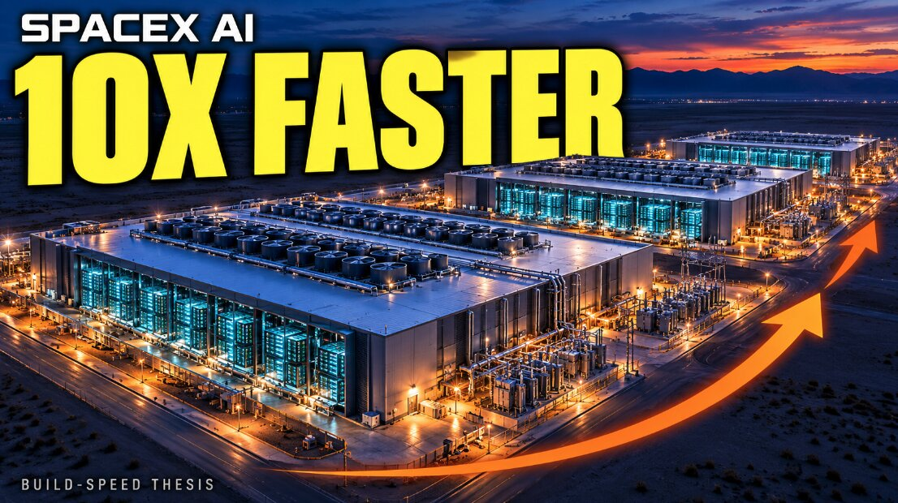

# AI基础设施量产提速10倍

> SpaceX 最有分量的新产品不是某一座巨型AI数据中心，而是每个月完工一座——当算力设施像二战护航航母一样被批量造出来，竞争的关键就不再是建成某一座，而是整条生产线的产能。

当巨型AI数据中心进入流水线节奏，单个项目的成就让位于整套生产系统的产能。

## 每月完工一座，才是真正的变量

在 Brian Wang 看来，SpaceX 最有分量的新产品不是某一座巨型 AI 数据中心，而是每个月完工一座巨型 AI 数据中心这件事本身。

单座庞大的算力设施固然震撼，但真正改变局面的是一套量产体系。别人花几年时间建一座出类拔萃的设施，而能够稳定地每月交付一座甚至更多，意味着所有瓶颈都被解决。目前多个厂址正在同时推进，各自处在不同的建设阶段。

## 二战船厂早就证明过这条路

庞大的复杂机器被批量生产，历史上并不是没有先例。二战期间，美国船厂就证明了：尺寸和复杂度并不会阻止工业化重复生产。

Kaiser 的 Casablanca 级护航航母项目一共造了50艘，每艘约搭载28架飞机。该级最后一艘 USS Munda 从1944年3月29日铺设龙骨，到7月8日服役，只用了101天。

这里拿来做对比的并不是航母本身的战力——Casablanca 级是护航航母，不是更大的 Essex 级舰队航母——而是生产方法：重复的设计、预制分段、协调供应商、并行施工。一旦设计变得可复制，衡量标准就会从某个项目多牛，转向整个生产体系能产出多少。

## 一座空壳不等于一座能跑的数据中心

这套经验对 AI 基础设施的意义很直接，但工厂涵盖的是让计算机真正通电开机所需的全部环节。一座封顶的建筑外壳，并不等于一座投入运营的 AI 数据中心。

供电接入、变电站、冷却、服务器、网络、软件和调试都必须同时到位，其中任何一环延后，都会让昂贵的设备搁在那里干等。标准化能减少每个站点重复投入的工程与协调工作：团队可以复用布局方案、采购规格、安装流程，以及此前部署积累的经验。

## 真正的考验在运营

不过，最终的检验标准是运营层面的：有多少容量真正通电、完成调试、可供客户使用并产生收入。Brian Wang 认为，这正是开工公告和实打实的工业优势之间的区别所在。
