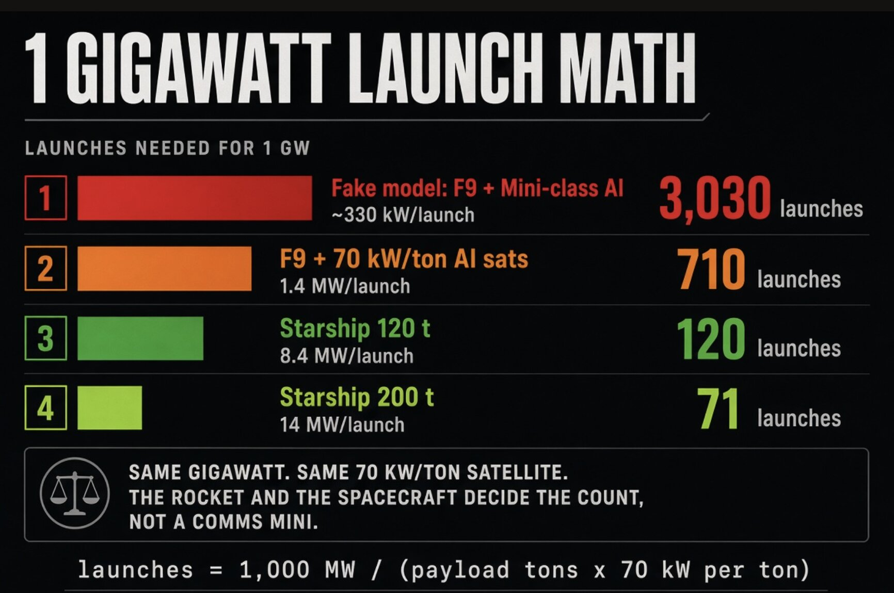

# SpaceX发射1吉瓦AI算力不到10亿美元

> SpaceX为1吉瓦太空AI算力付出的发射成本不到10亿美元，而市场上流传的1800亿美元估算，是把零售发射价当成内部成本算出来的电子表格惨案。

Falcon 9 的复用节奏决定了太空数据中心的真实成本，与零售报价相去甚远。

## 先用3000罐汽水算笔账

Brian Wang 开篇用一个汽水类比：假设你想买3000罐汽水，却按机场商店每罐5美元的零售价来买，而这家店只有20罐、也不批发——你就得跑15家店，总共花掉15000美元。作为个人，付最贵的零售价已经很蠢。

可如果你本身就是一家饮料灌装厂，这笔账完全不是这么算：卖给沃尔玛的30罐装，成本只有7美元；你需要约100箱，成本约700美元。再进一步，作为灌装厂，你可以直接做1加仑的大桶，每桶成本1美元，而一桶相当于30罐，100桶只要100美元。如果自己上高压罐，整个需求10美元就能解决。

这套逻辑，正是冲着把1吉瓦AI送进太空要花1800亿美元的估算去的。

## Falcon 9 的账本：报价6000万，自用1200万

按公开价格，客户从 SpaceX 买一次 Falcon 9 发射要付6000万美元。而 SpaceX 自己的成本是1200万美元。

原因是复用：Falcon 9 有80%的部分被重复使用。一枚全新 Falcon 9 造价约4000万美元，其中约3200万美元的部分会被反复使用30次，每次发射真正被替换掉的部分只值约800万美元。

## 根本没有3000枚火箭在停车场里等着

另一个被忽视的现实是产能。SpaceX 一年执行的 Falcon 任务量在160次左右，而不是3000次发射。这些任务大多来自内部的 Starlink 星座和既有客户；2028年以后的新商业 Falcon 9 订单已经在被拒之门外。2026年的 Falcon 发射清单里，大约五分之四是内部任务。

换句话说，市面上并不存在3000枚闲置的 Falcon 9 随时待命。

## 谁在制造电子表格惨案

在 Brian Wang 看来，用零售发射报价去乘3000次发射，得出1800亿美元这个数字，本身就是一桩电子表格惨案。他的原话是：能想出3000罐汽水花15000美元这种方案的人会被叫做白痴，而 Bank of America 等机构用零售级 Falcon 9 价格，去核算把1吉瓦 AI 送入太空需要3000次发射、总计1800亿美元，同样如此。
