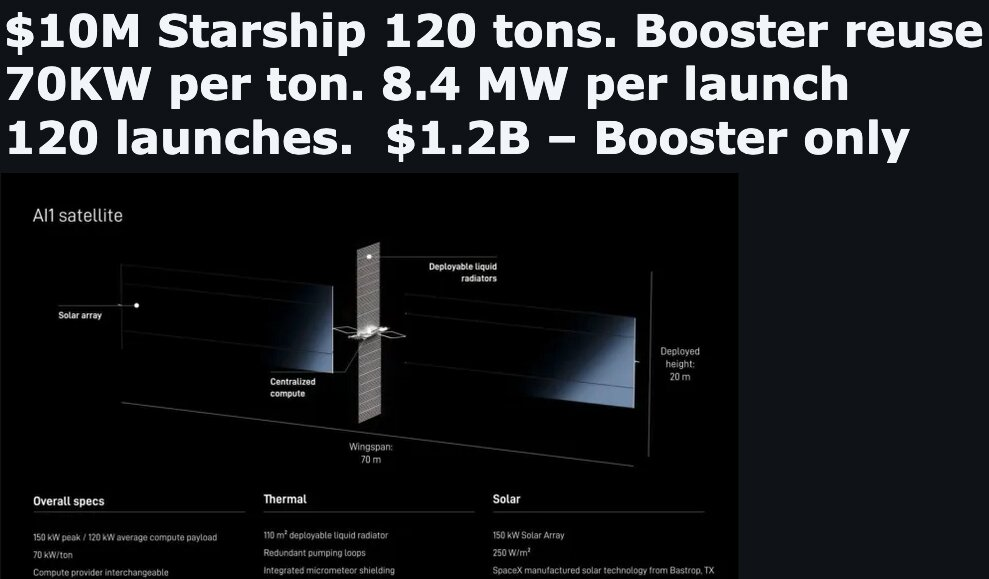

# 太空 AI 数据中心年部署量不超 10 吉瓦就毫无意义

> 要在 2030 年前把太空 AI 数据中心做到真正有分量，门槛大约是 10 吉瓦；理由很简单——地球每年新增的数据中心已是 20 到 40 吉瓦，太空这条新赛道只有做到同一量级，才谈得上改变全球格局。

太空 AI 数据中心要真正说得上话，年部署规模得达到 10 吉瓦以上。

## 为什么门槛是 10 吉瓦

在太空建真正有意义的 AI 数据中心，最低标准大约是到 2030 年前达到 10 吉瓦。因为地球每年新增的数据中心容量在 20 到 40 吉瓦之间；要创造一个新品类、真正撬动全球总量，太空 AI 必须达到相当可观的规模。

每年 1 吉瓦对 SpaceX 的收入而言已经算有意义，但即便如此，SpaceX 到 2026 年底就会有 3.2 吉瓦在运行。今年第四季度，SpaceX 将展示每月 500 兆瓦（0.5 吉瓦）的完工速度。如果这一节奏延续到 2027 年、并在 2028 和 2029 年进一步加快，那么即便没有任何太空 AI，SpaceX 在 2027 年也能新增 8 吉瓦。

按 Rubin 迷你硬件折算，22 万台数据中心相当于 2027 年每月 700 兆瓦（0.7 吉瓦）。而 SpaceX 基于地球的 AI 数据中心新增量，在 2028、2029 和 2030 年正朝着每年 10 到 20 吉瓦迈进。

## 每 1 吉瓦要发 120 次星舰

要达到这个最低门槛，实际需要的是每 1 吉瓦约 120 次星舰（Starship）发射。这是按 AI1 或 AI2 卫星每吨 70 千瓦时来估算的。

每颗 AI 卫星功率约 250 千瓦，重量约 2 到 4 吨。每次星舰需要装下 30 到 40 颗这样的卫星。这意味着，仅 10 吉瓦的太空 AI 容量，就需要上千次发射来支撑。

## FAA 的发射许可得翻倍

相应地，关于 FAA 允许每年 1000 次发射的讨论必须提上日程，而且要把上限提高到 2000 次以上。这样才能腾出约 1200 次专门用于 SpaceX 的 AI 发射。

即便如此，SpaceX 每年仍要用数百次发射来部署 V3 和 V4 通信卫星，以及执行 NASA 和其他任务。换言之，太空 AI 要真正成为一门有分量的生意，前提是发射能力的整个上限先被抬高一个档次。
