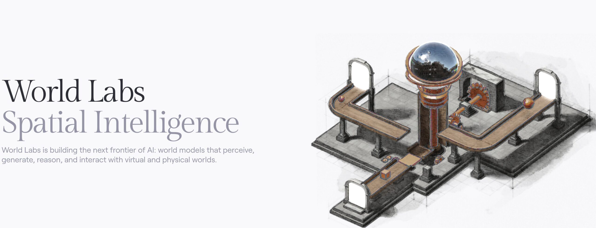

# AMD82亿美元买下李飞飞的World Labs，押注「世界模型」

> AMD 以约 82 亿美元股票收购李飞飞的 World Labs，李飞飞出任 AMD 执行副总裁兼首席科学家，直接向苏姿丰汇报。这个价格比 World Labs 此前 50 亿美元的估值传闻高出约 64%。

对市值刚破万亿美元的 AMD 来说，这是笔约 0.8% 的小赌注，赌的是下一代 AI 需要「理解物理世界」的模型。

## 82亿美元，买下的是团队和技术栈

AMD 同意以约 82 亿美元的股票收购李飞飞博士的 World Labs，并安排她出任公司首席科学家。据 Rohan Paul 称，这比 World Labs 在 2 月一轮 10 亿美元融资时流传的 50 亿美元估值高出约 64%——那一轮 AMD 和 Nvidia 都参与了。

李飞飞将出任 AMD 执行副总裁兼首席科学家，直接向 CEO 苏姿丰（Lisa Su）汇报。World Labs 此前已与 AMD 在训练和推理上展开合作，AMD Ventures 更早就投过。

## 对 AMD 而言，这不是定生死的交易

这笔赌注的体量值得说清：AMD 近期市值刚突破约 1 万亿美元，82 亿美元约占其中的 0.8%，而不是「不到 0.1%」。放在 AMD 的估值面前，以及对比当年 500 亿美元收购 Xilinx 的交易，这笔钱都算小。按 CNBC 的说法，这是一笔研究和路线图层面的下注，而非决定资产负债表的交易。

AMD 真正买到的，也不是一个能模拟所有物理和化学的模型，而是一支做空间智能的团队与技术栈：能够从文本、图像、视频重建、生成并模拟可交互 3D 世界的模型，再加上机器人仿真（包括此前对 SceniX 的收购）。AMD 给出的理由是「协同设计」——下一代模型会告诉他们，接下来芯片、系统和软件必须做到什么。Nvidia 已经有自己的 Cosmos 世界模型，AMD 在这一块一直偏薄。

## 「语言是不够的，宇宙由事物构成」

李飞飞自己的说法是：语言是不够的。宇宙由事物构成，而不是由词语构成。科学、机器人、设计这些难题，需要能够对物理世界的结构与行为进行推理的模型。她明确把药物发现、创造力、学习和下一代机器人列为目的地。
