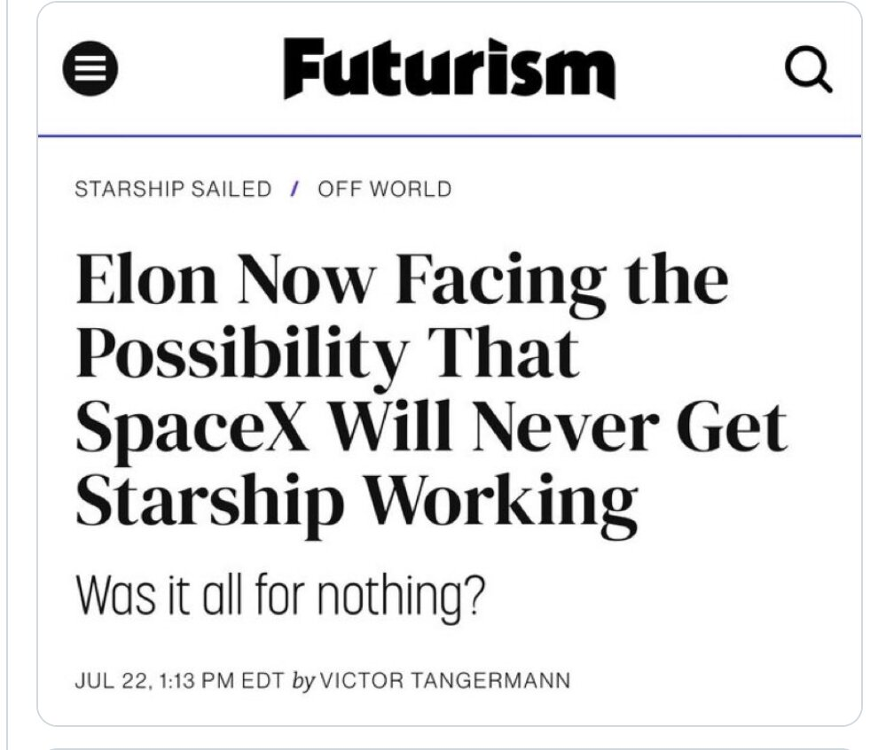

# 当初断言星舰「永远不会成功」的人，今天被打脸了

> 星舰入轨并部署卫星后，NextBigFuture 列出了一份名单——那些曾断言星舰不会成功、或存在致命设计缺陷的人，从《科学美国人》《纽约》杂志到 Futurism，都被点了名。

这篇帖子最后的邀请很直白：还有谁该被列进来，欢迎在评论区补充。

## 一份「他们错了」的名单

随着 SpaceX 星舰入轨成功，NextBigFuture 发布了一份名单：那些曾经预测星舰不会成功、或认为它存在致命设计缺陷的人。

帖子的语气毫不客气——名单的用途被直接写明：现在我们要记住并嘲笑他们错了。文末还向读者征集，谁还该被列进来。

## 名单上都有谁

Will Lockett（Planet Earth and Beyond）。他的标题直截了当：「Starship Will Simply Never Work」（星舰永远不会成功）、「Starship: Dead End?」（星舰：死路一条？）、「Starship Is Going Nowhere」（星舰哪儿也去不了）。他的论点是这枚火箭太重太脆，有效载荷会长期接近于零，完全复用「基本不可能」。这些观点被《纽约》杂志、《科学美国人》和 Futurism 引用过。

《科学美国人》，2025 年 8 月 21 日，《Why Do SpaceX's Starships Keep Exploding?》（为什么 SpaceX 的星舰一直在爆炸？）——把接连的爆炸描述为可能是根本性的设计失败，并引用了 Lockett。

《纽约》杂志 / Intelligencer，Jeff Wise，2025 年 7 月 21 日：「Is Elon Musk's Starship Doomed? The future of SpaceX keeps blowing up, and no one knows if he can fix it.」（马斯克的星舰要完了吗？SpaceX 的未来不断爆炸，没人知道马斯克能不能修好。）

Futurism，Victor Tangermann，2025 年 7 月 22 日，标题正是截图里那句：「Elon Now Facing the Possibility That SpaceX Will Never Get Starship Working — Was it all for nothing?」（马斯克如今面临一种可能：SpaceX 永远造不出能用的星舰——这一切都白费了吗？）

Common Sense Skeptic（YouTube，约 11.9 万订阅）。多年来坚持「星舰是画饼、设计有致命缺陷、马斯克在载荷和复用上撒谎」，产出过大量针对星舰和火星计划的批评视频。
