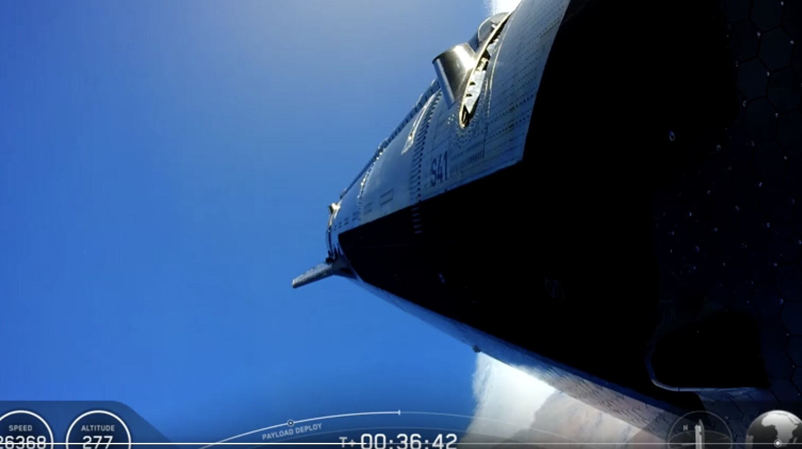

# 星舰入轨并部署商业V3卫星：120次发射就能在太空点亮一吉瓦AI

> 星舰 Flight 14 入轨成功（中途一台发动机熄火），并部署了 26 颗商业卫星——这个载荷量相当于 SpaceX 带一台可用猎鹰9号的头一年半总量。用新型 AI1 卫星，120 次星舰发射就能在太空凑出一个吉瓦的 AI 算力。

猎鹰9号干不了这活：换小型 AI 卫星需要 700 到 3000 次发射，而那种「迷你 AI 卫星」根本不会被造出来。

## 入轨成功，一台发动机熄火

SpaceX 的星舰已经进入轨道。第 14 次飞行（Flight 14）总体成功，不过中途有一台发动机熄火。

如果 SpaceX 用新型 AI1 卫星完成 120 次星舰发射，那就是太空中的一个吉瓦级 AI。SpaceX 不会为猎鹰9号专门造 AI 卫星；若改用某种搭载 AI 芯片的小型卫星，则需要 700 到 3000 次猎鹰9号发射。而「迷你 AI 卫星」永远不会被造出来，猎鹰9号和这种小卫星也不可能在 10 到 20 年的猎鹰9号发射量里完成这个任务。

## 26颗卫星 = 早期一年半的全部载荷

星舰第 14 次飞行仍部署了 26 颗商业卫星。这个载荷量，相当于 SpaceX 作为一家公司、带着一台能用的猎鹰9号时，头一年半的全部发射量。

这 26 颗 V3 星链提供的容量合计 26 Tbps，约等于十次满载的星链猎鹰9号发射（每次 270 颗 V2 mini）。

## 助推器复用：每公斤成本跌破200美元

本次飞行还有一次漂亮的模拟助推器着陆。星舰助推器此前已被回收 3 次、复用 2 次，那些都是 V2 版星舰助推器。

星舰助推器的回收与复用不需要隔热罩，这意味着复用 5 次以上可把发射成本压到每公斤 200 美元以下，复用 30 次则低于每公斤 100 美元。

即便完全不复用，对 SpaceX 来说，星舰也已经是对地轨道上每公斤成本最低的火箭。
