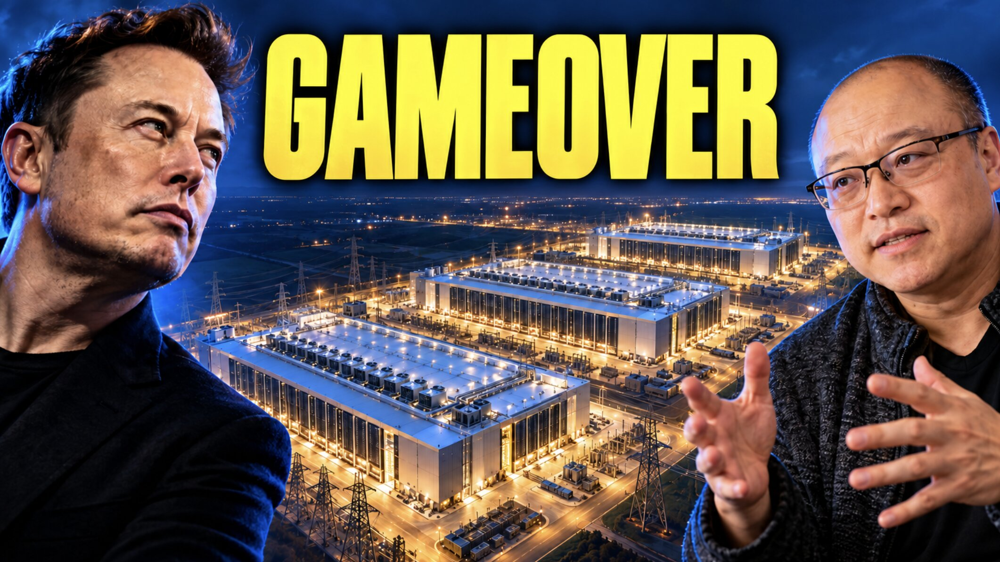

# 每月下线一座AI数据中心：SpaceX的「MiniHard」利润可顶800万辆Robotaxi

> 按 Brian Wang 的模型，一座 0.5 吉瓦当量的 MiniHard 满租后年收入可达 250 亿美元；每月交付一座、持续一年，2027 年经营利润约 750 亿美元——这需要特斯拉同年造出 800 万辆能赚钱的 Robotaxi 才能持平。

标准化的价值不在省下多少工程，而在于让客户早几个月用上算力、早几个月开始赚钱。

## 一个月一座AI数据中心

一个月交付一座新的 AI 数据中心。如果 SpaceX 真能保持这个 MiniHard 生产节奏，它对 AI 产能、收入和竞争格局的冲击将是巨大的。

MiniHard 将成为 SpaceX 近期最重要的产品。反复交付一套已被验证的数据中心设计，能把一个个独立的建设工程，变成源源不断可用的 AI 算力。

Brian Wang 把它类比成量产并完全变现的特斯拉 Robotaxi：SpaceX 整个 2027 年的 MiniHard 产出，利润相当于特斯拉在 2027 年造出 800 万辆 Robotaxi 的情形。

一座建成的建筑本身不赚钱。电力、GPU、冷却、网络、调试，以及愿意付钱的客户，才决定这套「工厂论」能否变成真实的生意。

## 一座MiniHard，年收入25亿美元

模型假设一座「0.5 吉瓦当量」的 MiniHard 在完全出租并投运后，按每吉瓦每年 500 亿美元计费，即年收入 250 亿美元。按示例性的 50% 经营利润率，单座完全变现的单元一年可贡献 125 亿美元经营利润。

这些都属于情景假设：产能、可实现的租赁价格、利用率和利润率，每一项都必须成立。

## 12座 = 3000亿美元收入体量

每月交付一座、持续 12 个月，这支机队就新增了 6 吉瓦产能，完全变现后可支撑每年 3000 亿美元收入和 1500 亿美元经营利润。

但 12 月才开张的单元当年赚不到 12 个月的钱。假设每座在月中完全投运，这 12 座在首个自然年里相当于贡献 6 座全年等效单元，据此 2027 年经营利润约 750 亿美元。这个测算只针对新增产线，不含 SpaceX 现有的 AI 产能。

## 换成特斯拉：每辆Robotaxi要赚1.875万美元

给特斯拉上同样的时间表：假设它在 2027 年内均匀部署 800 万辆能产生收入的 Robotaxi，全年累计约等于 400 万「车年」的运营量。要匹配 MiniHard 项目模型中的 750 亿美元 2027 年经营利润，每辆车每年需贡献 750 亿 ÷ 400 万 = 1.875 万美元经营利润。

到年底，这支 800 万辆的车队将支撑每年 1500 亿美元经营利润，与 12 座 MiniHard 的模型运行速率相同。这才是同口径的对比：两个生产项目在同一年里爬坡。

这 1.875 万美元必须是扣除运营成本和折旧后归属于特斯拉的利润，不能是全部车费，也不能把卖车利润和车队服务利润混在一起。如果 800 万辆从 1 月 1 日起就全部运营，每辆只需 9375 美元即可持平——部署时点会显著改变答案。

## 关键在于「可重复」

标准化的价值在于减少重复工程、简化采购，让安装调试更可预测；真正的奖赏是更早变现。SpaceX 的机会就是反复交付这种可用产能。

但这套「工厂论」能否成立，取决于电力是否接通、芯片是否装机、冷却与网络是否可用、调试是否完成，以及客户是否按模型价格付费。经营利润率还要吸收 GPU 折旧等真实成本，而经营利润也不等于自由现金流——建下一批机队需要巨额资本。

按模型推演，MiniHard 首年即可产生 750 亿美元经营利润，在经济学不变的前提下，次年还可能升至 2250 亿美元。它能否成为全球最赚钱的产品家族，取决于 SpaceX 能否把一次成功交付，变成一张可重复执行的算力交付时间表。
