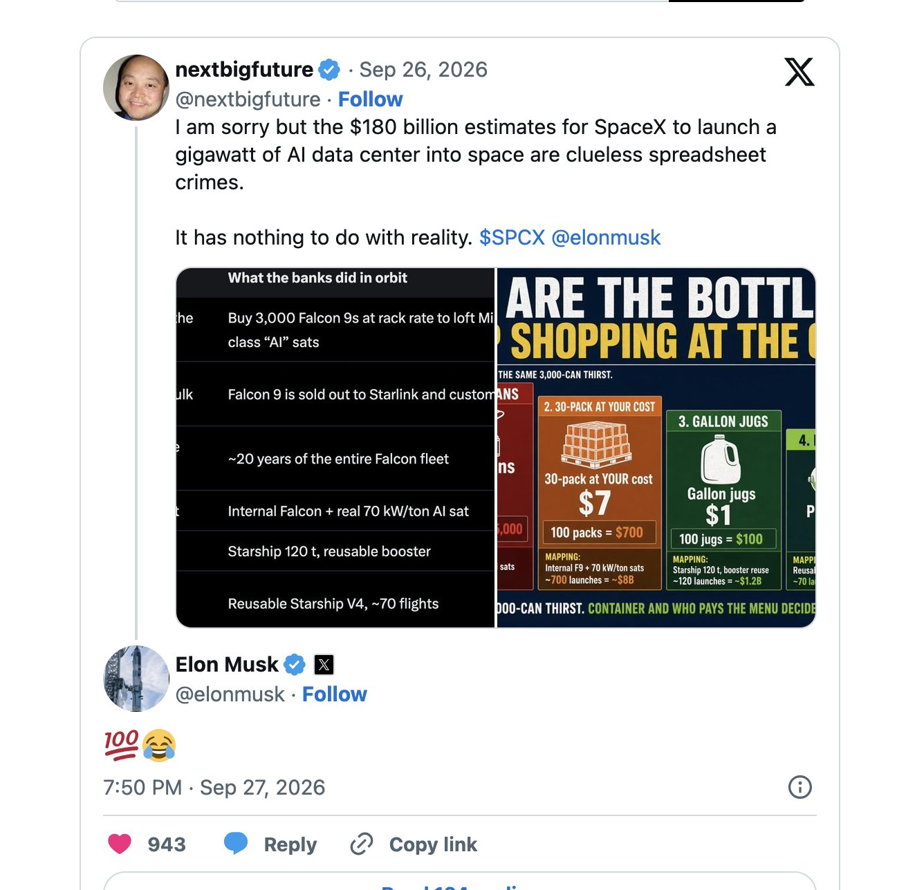

# 马斯克回了一句「100%」和一个笑哭表情，给这场太空AI成本之争站了队

> 针对那些说 Brian Wang 错了、美国银行关于「太空AI每吉瓦成本」的判断才对的人，马斯克在他 X 帖下回复了「100%」加上一个笑哭表情。

「1 吉瓦花 1800 亿美元，可笑。」——在 Brian Wang 看来，这类估算是不知天高地厚的「电子表格罪行」。

## 一句「100%」和一个笑哭表情

对于那些说我错了、说美国银行关于「太空 AI 每吉瓦成本」的判断才对的人，马斯克已经给出了回应：他在我的 X 帖子下回了一句「100%」，外加一个笑哭表情。

同一天上午，SpaceX 还把星舰送入轨道并部署了商用 V3 卫星。如果 SpaceX 改为按月发射满载的 V3 卫星，而不是如今的一半载荷，其带来的星链容量将超过 160 次猎鹰9号发射。

## 「1800亿美元」是怎么来的

在 Brian Wang 看来，星舰即便尚未复用，也已经是成本最低的发射方式。他直言，那些「SpaceX 要把一个吉瓦的 AI 数据中心送入太空得花 1800 亿美元」的估算，是「不知天高地厚的电子表格罪行」。

「这跟现实毫无关系。」他在帖子里写道。另一条回复更不客气：「这说明你根本不知道火箭正是 SpaceX 在做的事。1 吉瓦花 1800 亿美元，可笑。」

## 争论的焦点其实是单位算力的上天成本

这场争论的核心，是把每单位算力送上轨道的成本。太空中的数据中心的电力和散热条件远优于地面，但把设备送上轨道的费用，一直是最大的质疑点。当投行分析师与主张太空 AI 的一方各执一词时，马斯克用两个字符的表态，等于站到了「这个数字离谱得没边」的那一边。
