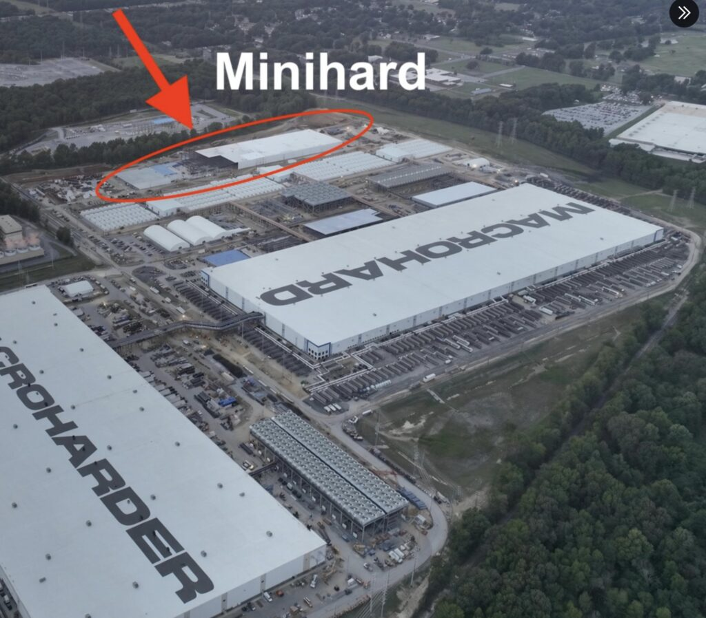

# 20个SpaceX MiniHard能否比800万辆特斯拉Robotaxi更赚钱

> 一条视频抛出的对比：20座SpaceX MiniHard AI数据中心与800万辆满负荷变现的特斯拉Robotaxi，究竟哪个创造的利润更高。

SpaceX MiniHard数据中心与特斯拉Robotaxi收益对比

## 一个耸动的对比

视频抛出一个耸动的问题：20座SpaceX MiniHard AI数据中心，对决800万辆已完全变现的特斯拉Robotaxi，谁能创造更多利润。

作者Brian Wang拆解了MiniHard月度产量的冲击、AI算力租赁的经济性，以及这一对比背后的各种假设。

## 关键变量

核心在于SpaceX能以多快的速度，把电力、芯片和建筑转化为可收费的算力。

原文本身是一段视频的导语，正文只有简短摘要，并未给出结论性数字。

## 内容说明

该帖主要充当视频的引子，文字部分只交代了对比框架与关注点。

若要得到具体收益结论需观看视频，文中并未提供可核实的数据。

