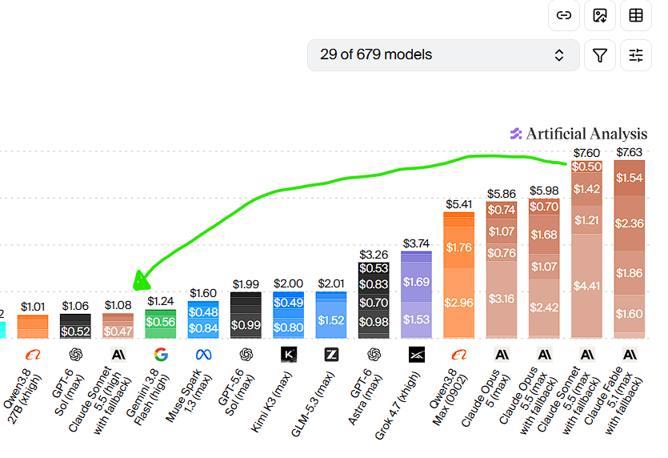

# AI顶级模型几乎每隔几天就更新一版

> 顶级模型近乎按天迭代，Claude Opus 5.5被视为质量标杆，而Sonnet 5.5以“高”档运行号称便宜七成、却能达到GPT-6 Sol的质量。

各主流AI模型定位一览

## 发布节奏几乎按天计

谷歌正在发布Gemini 4 Argon，被认为具备竞争力。

Claude Sonnet 5.5的使用成本低得多，建议在“高”档下使用。

新模型几乎每天都在发布。

## 各家模型定位一览

Claude Opus 5.5：质量领跑者。

Claude Sonnet 5.5：顶级模型中性价比最高。

GPT-6 Astra：主打智能体、电脑操作与数学。

GPT-6.1 Sol：廉价的准旗舰。

Gemini 4 Argon：纸面实力不俗，但尚未普遍可用。

Grok 4.7：西方最便宜的旗舰，在硬核智能体与编程评测上低一个档次。

## 谷歌正式预告Gemini 4 Argon

谷歌CEO桑达尔·皮查伊9月30日发推预告Gemini 4 Argon，称其在复杂工作流、网络防御与软件工程上展现前沿性能。

皮查伊还表示，谷歌内部团队已大量使用该模型。

## 用户力推Sonnet 5.5高档

有用户在社交媒体上呼吁Claude用户只用Sonnet 5.5的“高”档，称其便宜七成。

该用户称用20美元套餐就能完成大量任务，且高档Sonnet 5.5可获得GPT-6 Sol级别的质量。

