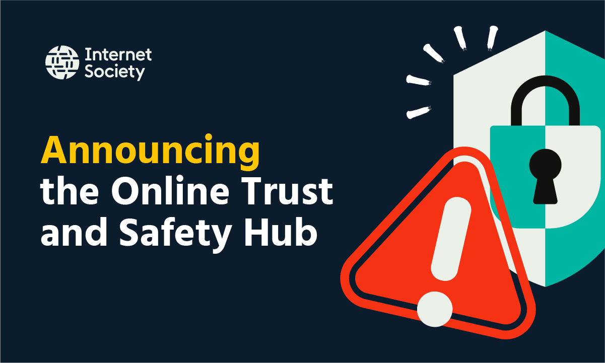

# 互联网协会推出全球在线信任与安全中心

> 互联网协会发布免费、多语言的“在线信任与安全中心”，集中提供反诈骗指南、课程、视频以及谷歌的“Be Scam Ready”游戏，帮助普通人识别网络风险。

互联网协会“在线信任与安全中心”发布

## 免费多语言的全球资源中心

互联网协会今日推出“在线信任与安全中心”（Online Trust and Safety Hub），这是一个免费的多语言全球资源中心，提供实用工具帮助人们更安全、更自信地上网。

该中心是互联网协会“更安全互联网倡议”的关键组成部分，旨在为个人和社区提供应对网络风险所需的知识与资源。

与此同时，它也在推动政府、产业、平台与民间社会承担让互联网更安全、更可信的更广泛责任。

## 诈骗利用的是人性弱点

网络诈骗日益利用人们熟悉的情感——信任、紧迫感、恐惧、希望与孤独，任何人都可能成为目标，与年龄、背景或技术水平无关。

互联网协会强调，保持安全不应需要专业知识。

该协会杰出技术专家约瑟夫·洛伦佐·霍尔博士表示，骗子针对的不是某一类人，而是使人之所以为人的特质；反诈指引不应复杂。

## 中心提供的内容

中心免费汇集反诈骗指南、教育视频、在线课程、可下载材料、精选资源，以及谷歌的“Be Scam Ready”游戏。

它面向个人互联网用户、互联网协会全球社区（如各地分会和培训师），以及其他社区组织与可信网络。

其开发参考了来自社区的研究与洞见，包括服务女性主导组织、流离失所人群、原住民社区以及新近接入互联网人群的机构。

该中心及反诈资源由互联网协会开发，得到广泛社区参与和Google.org的支持，网址为 onlinesafety.internetsociety.org。

## 安全不只是个人责任

尽管实用知识能帮助人们识别和应对网络风险，互联网协会强调在线安全并非仅靠个人。

平台、产业、政府与民间社会都必须采取行动，营造更安全的在线环境。

## 关于互联网协会

互联网协会由互联网先驱于1992年创立，是一家致力于确保互联网属于所有人的全球非营利组织。

它通过会员社区、特别兴趣小组和全球130多个分会，维护并推广让互联网保持开放、全球互联与安全的政策、标准及协议。

