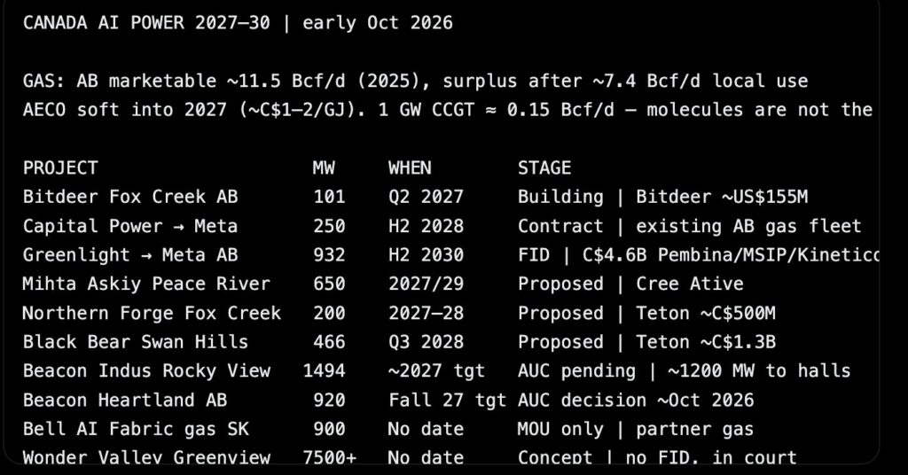

# 加拿大AI数据中心项目与为AI供电的能源版图

> 艾伯塔省以“自带发电”模式成为加拿大AI数据中心供电的主战场，但本十年的现实上限仅为个位数吉瓦，远低于外界热炒的数十吉瓦。

艾伯塔省AI数据中心与燃气发电项目分布示意

## 艾伯塔聚焦天然气自发电

近期为AI和高性能计算数据中心配套的天然气发电，主要集中在艾伯塔省，采用“自带发电”模式。

多数大型项目仍处于提案或审批阶段，只有少数已作出最终投资决定、签订施工合同或购电协议。

艾伯塔2025年可售天然气供应约11.5 Bcf/d，并有望到2027年仍处盈余；即便文中所有与AI相关的燃气电厂全部建成，耗气量也远低于1 Bcf/d。

已相对确定落地的AI数据中心项目规模约为6吉瓦。

## 本十年的现实上限

本十年艾伯塔新增燃气发电AI负荷的现实上限为个位数吉瓦，其中以Greenlight计划2030年投产的0.9吉瓦领衔，其余取决于能否通过AUC审批和燃气轮机排队。

40吉瓦要等到2035年才可能成为工业级规划，前提是超大规模企业签下长期天然气与电力合同、轮机制造商同步扩产；该盆地有供气能力，但2027至2030年的项目队列中目前无一走在这条轨道上。

不同AI规模所需的天然气量大致为：40吉瓦基荷约需6至7 Bcf/d，80吉瓦约需12至13 Bcf/d。

加拿大西部2025年产量已创纪录约19.1 Bcf/d（艾伯塔约11.4至11.5，不列颠哥伦比亚约7.4），艾伯塔本省自用约7.4 Bcf/d，再加6至7 Bcf/d支撑40吉瓦是可行的。

## Meta在艾伯塔的大手笔

Meta正在艾伯塔省建设其加拿大首座大型数据中心，看中的是当地充沛的能源与友好的监管环境。

这是Meta在全球的第33座数据中心，选址斯特金县；该地长期划为工业用途，且所处区域具备扩建能源基础设施的容量。

Meta称与Greenlight有限合伙、Altalink、Capitol Power以及艾伯塔电力系统运营商等多家加拿大能源企业合作，提前数年规划能源需求。

这座1吉瓦设施预计耗资约90亿美元，建设周期两到三年。

## 已获资金与购电协议的项目

Greenlight电力中心（为Meta配套）位于艾伯塔斯特金县，装机932兆瓦联合循环天然气发电、获批可扩至1864兆瓦，采用西门子能源SGT6-8000H机组，耗气约150 MMcf/d，目标2030年下半年投运。

该项目2026年7月作出最终投资决定，主要监管批准到位，约85%资本成本锁定在固定价协议中，工程总承包授予TRA（Aecon控股，联合Técnicas Reunidas），Aecon份额约17亿加元，项目成本约46亿加元。

Meta毗邻园区是一个超130亿加元（亦有报道称约90至100亿美元以上）的AI数据中心，初期约1吉瓦并可扩展至约1.8吉瓦，2026年7月开工。

过渡供电方面，Capital Power自2028年下半年起从其艾伯塔现有机组提供250兆瓦、为期十年以上的长期合同；Meta还获得AESO约970兆瓦的第一阶段负荷配额。

Bitdeer Fox Creek项目约101兆瓦自备天然气电厂，搭配约100兆瓦算力，2026年6月动工，目标2027年第二季度送电，成本约1.55亿美元。

## 提案审批阶段项目与核电路线

瞄准2027至2029年的燃气项目多在审批中：Mihta Askiy约650兆瓦分期建设、2027年起，Northern Forge约200兆瓦、2028年完成，Black Bear约466兆瓦联合循环、目标2028年第三季度。

Beacon AI枢纽中，Indus园区拟建约1494兆瓦燃气热电厂供应约1200兆瓦数据大厅，2026年8月已举行听证、裁决待定；Heartland园区约800至920兆瓦燃气机组，裁决预计在2026年10月底前后。

Bell AI Fabric位于萨斯喀彻温省Regina附近：原有约300兆瓦园区使用省级电网，2026年9月与省政府签下不具约束力的谅解备忘录，拟分期扩容至多900兆瓦、总规模约1.2吉瓦，但目前没有具名燃气伙伴、最终投资决定或施工合同。

Wonder Valley（O'Leary Digital）是超大型早期构想，常被提及约7.5吉瓦，仍处于法院审理与环境评估环节，尚无公开的最终投资决定。

安大略Darlington新核电项目规划四台GE Hitachi BWRX-300小型模块化反应堆（每台约300兆瓦、合计约1200兆瓦），首台在建、目标约2030年商业运行，属电网供电而非专属AI购电。

