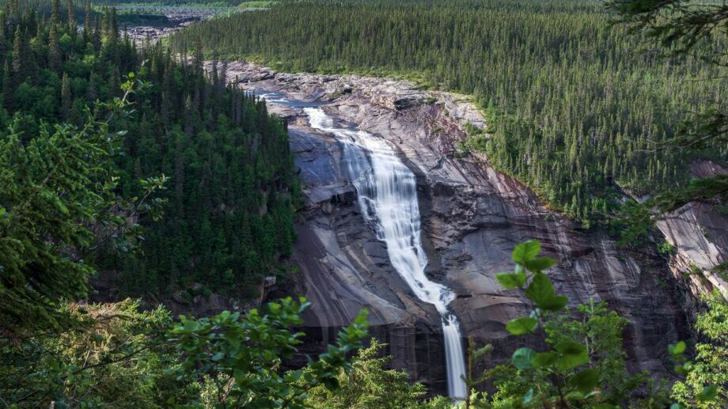

# 加拿大拟 2037 年建成巨型水电群，规模约为三峡的一半

> 加拿大最大的能源项目落在拉布拉多半岛的丘吉尔瀑布—鸥岛（Gull Island）一揽子计划上：投资近 700 亿美元、总装机约 1.4 万兆瓦，号称北美史上最大的清洁能源投资，规模约为中国三峡大坝的一半。

丘吉尔瀑布—鸥岛计划，是北美史上最大的清洁能源投资。

## 近 700 亿美元，北美史上最大清洁能源投资

加拿大最大的能源项目，如今是拉布拉多半岛上的丘吉尔瀑布—鸥岛（Churchill Falls–Gull Island）一揽子计划。它耗资近 700 亿美元，是北美历史上最大的清洁能源投资；整个计划将带来约 1.4 万兆瓦的清洁电力——相当于在现有丘吉尔瀑布电站的基础上，再加上新的水电和风电，规模接近现有电站的三倍。

它还将创造约 2.3 万个建设岗位，到 2040 年代初贡献约 310 亿美元的 GDP。

## 三块拼图：改造、新建与风电

第一块是丘吉尔瀑布的升级改造：对现有电站的 11 台机组进行翻新，预计把装机容量提高约 23.5%，也就是约 1275 兆瓦；联邦文件还提到最多再扩容约 2500 兆瓦。现有容量约为 5428 兆瓦。

第二块是鸥岛（Gull Island）新建电站，位于丘吉尔河上、丘吉尔瀑布下游，距 happy valley-goose bay 西南约 100 公里。规划装机约 2250 至 2700 兆瓦（2700 兆瓦、六台机组），资本成本估计约 290 亿美元，由魁北克水电公司（Hydro-Québec）承建，合资股权框架为纽芬兰与拉布拉多水电（NL Hydro）占 60%、魁北克水电占 40%。

第三块是风电：计划在拉布拉多建设最多约 2000 兆瓦的陆上风电，由因纽特人（Innu）共同投资。

