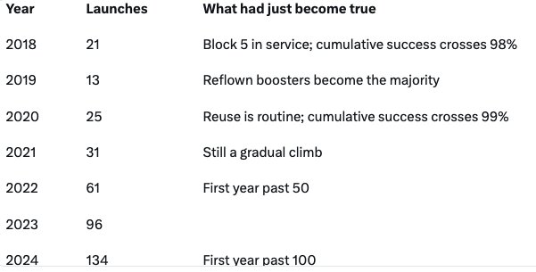

# 火箭一年发射超二十次为何如此罕见

> 全球目前只有中国和SpaceX实现年发射超过50次，而猎鹰9号是唯一在单一发射台做到年发射逾50次的火箭。

猎鹰9号火箭发射资料图

## 高发射频率的门槛

无论是某一款火箭，还是同一族火箭，能把年发射量做到20次以上的都寥寥无几。从任意数量的发射台把年发射量做到50次以上，则更加罕见。

要把年发射提到20次，需要96%至98%的发射可靠性，这对绝大多数火箭和发射场均难以企及。

猎鹰9号是唯一实现单发射台年发射超过50次的火箭。

目前只有中国和SpaceX做到年发射超过50次。中国沿用俄罗斯式路径，靠大量发射台与大量一次性火箭堆出高频率。

## 猎鹰9号从九成到九成八的爬坡

猎鹰9号是记录最完整的案例，其可靠性的跃升靠的是发射频次，而不是某一次神奇的设计评审。

直到2016年，它仍是一款约90%成功率的火箭：2012年CRS-1部分失败、2015年CRS-7任务损失、2016年AMOS-6在地面测试中随火箭一起炸毁。

2017年1月复飞后，猎鹰9号一路干净利落，Block 5版本于2018年5月投入使用。

大约在2019至2020年、连续50到60次成功后，累计成功率终于突破95%，统计下界逼近98%。

## 三到四年，以及两百五十次连胜

从“坏年份之后约90%”提升到站得住脚的98%，花了大约三到四年，而且前提是SpaceX当时每年已经在发射15到25次。

2024年7月的失败把终身数据拉低了不到一个百分点，随后的250次连续成功又让Block 5重回约99.8%的水平。

换句话说，高发射频率既是可靠性提升的结果，也是它得以持续的原因。

