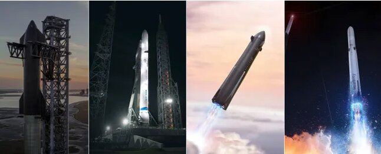

# 猎鹰9号的竞争者或将在2027年首飞

> 猎鹰9号一年完成160至170次发射、送入轨道约2500至3000吨，而一批对标它的新火箭，首次飞行大多要等到2027年。

 尽管多款新火箭目标直指猎鹰9号，其首飞时间表大多已滑向2027年。

## 猎鹰9号树立的基准

SpaceX猎鹰9号在可重复使用模式下近地轨道运力约15至18吨，一次性使用约23吨，助推器常年飞行20次以上，整个机队每年执行数十次发射。2025年猎鹰9号完成160至170次发射，2026年可能持平，全年送入轨道约2500至3000吨。除中国的长征系列外，没有其他火箭或发射服务商一年能把超过100吨载荷送入轨道。

## 星舰与新格伦

SpaceX的超级重型星舰已把逾50吨送入轨道，看起来将把单次发射入轨量提升到每月100至120吨。若SpaceX用星舰V3实现每月三次发射，其入轨载荷就将超过猎鹰9号。

蓝色起源的新格伦火箭配备可重复使用的一子级，近地轨道运力约45吨。它于2025年首飞，2025年11月回收了一枚助推器，并于2026年4月复用该助推器。2026年5月一次发射台热试车异常摧毁了运输起竖装置，导致火箭停飞。蓝色起源正在重建36号发射台，仍把2026年底重返飞行作为目标，但迄今飞行次数仅寥寥数次。他们讨论过更大的"9×4"构型，长远目标是每年超过100次发射，但近期并无实现该频次的日程。

## 新一代中型火箭竞逐

Relativity的Terran R火箭在助推器海上着陆并复用的情况下，近地轨道运力约23.5吨，一次性使用约33.5吨。硬件正处于集成装配阶段（飞行发动机已装到推力结构上，级间测试进行中）。Relativity Space的目标是从卡纳维拉尔角LC-16在2026年底发射，但外部观察者普遍预计会推迟到2027年。

火箭实验室的Neutron目标为可重复使用近地轨道运力13吨（海上着陆），返回发射场着陆约8.5吨，一次性使用15吨，一子级复用并采用"饥饿河马"式抱合整流罩。在沃洛普斯的发射台交付仍瞄准2026年第四季度。火箭实验室表示，2026年实际发射的窗口正在收窄，2027年首飞的可能性越来越大。他们描述的初期节奏大致是第一年一次、第二年三次、第三年五次。

## 更激进的复用路线

Firefly与诺斯罗普·格鲁曼合作的Eclipse目标近地轨道运力约16.3吨，一子级设计为日后复用（计划在早期一次性飞行之后实现返回发射场着陆），首次飞行不早于2027年。

Stoke Space的Nova Pathfinder（约3吨级，两级完全复用）目标定在2027年初，计划在2027至2028年进行多次飞行。Nova Block 2（近地轨道运力15吨，两级完全复用）目标为2029年。这是这一批火箭中最大胆的复用架构，但仍处于首飞之前。

