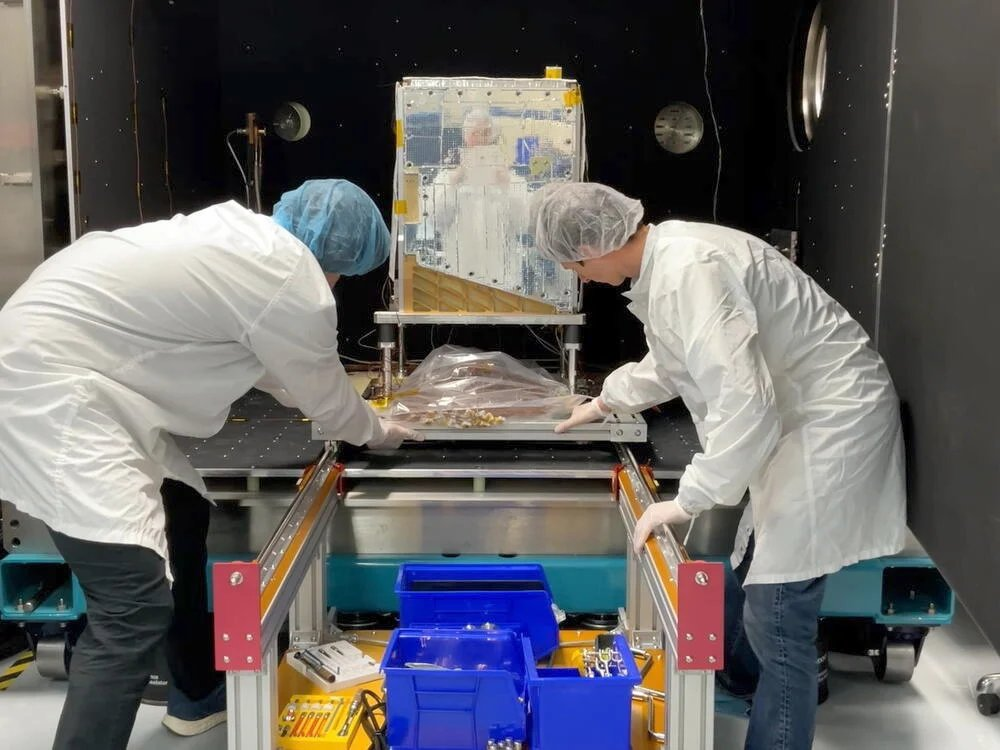

# 谷歌四枚TPU升空 探索太空AI的规模化与改进

> 2026年10月1日，谷歌携手Planet Labs用SpaceX拼车任务把搭载四枚TPU的原型卫星送入轨道，迈出“太阳捕手计划”的第一步。

谷歌“太阳捕手计划”卫星构想图

## 原型卫星入轨

2026年10月1日，谷歌与Planet Labs合作，借助SpaceX的Transporter-18拼车任务，把一颗搭载四枚TPU的原型卫星送入轨道。

这次发射是“太阳捕手计划”（Project Suncatcher）的第一步；谷歌的长期目标是有一天在太空承载可规模化的机器学习基础设施。

## 在轨验证抗辐射与散热

未来数周内，团队将收集在轨数据，考察谷歌TPU如何应对太空中的物理应力、辐射以及冷热极端。

这些数据将用于改进后续设计。

## 早期可行性验证

本次任务属于早期的可行性试探，谷歌尚未公布更具体的后续计划、部署规模或时间表。

