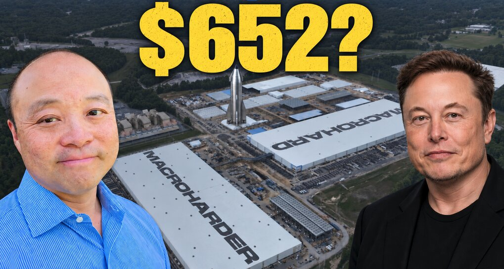

# SpaceX 的“AI 建造速度”会让华尔街再次看错

> SpaceX 正以“每月完工一座”的节奏，建起地球上最大的几座 AI 数据中心。作者 Brian Wang 指出，当建设周期从两到四年压缩到五个月，分析师用年度收入预测去套这家公司，很可能再次低估它的增长曲线。

当数据中心以“月”为单位完工，财务预测的尺子就不够用了。

## 五个月的工程，对两到四年的工程

SpaceX 业务里最重大的近期变化正在发生，未来几个月会变得格外明显：他们每个月都在建成地球上最大的几座 AI 数据中心之一。

Brian Wang 在最新视频中检视了 Macrohard、Macroharder 和 Minihard 这几项建设计划，并提出一个判断：当建设周期以“月”为单位来衡量，传统的收入预测就会落后于现实。

拿两个项目对比：一个是五个月完工，另一个要两到四年。这大约是 4.8 到 9.6 倍的速度差。财务上的后果很直接——能更早拿到可用算力，也就意味着这些产能能多出好几个月去创造收入。

## “每月完工”靠的是并行

一家公司并不需要在一个月内建好整座数据中心，才能做到每月完工一座。它需要的是多个项目同时推进、完工日期相互错开——这正是 Minihard 设想的核心。如果 SpaceX 能复制设计、提前锁定设备、让多个工地同时开工，这项业务就开始像一条有规律交付的产品线。

但光有建筑还不够。电力、制冷、网络和芯片必须同步就位，决定性的里程碑是“可用算力”。按每吉瓦每年 500 亿美元这一模型假设，一个满租的 500 兆瓦区块代表约 250 亿美元的年化收入潜力，折合约每月 20.8 亿美元。

## 收入节奏与年度预测的错位

这不意味着新落成的大楼会立刻为当年贡献 250 亿美元收入。完工日期、客户验收、利用率、定价和自用都会影响结果——12 月开业和 1 月开业，对全年贡献的差别很大。在拿 SpaceX 的年末收入节奏与华尔街的年度预测作比较时，这个区别至关重要。

视频里还收录了黄仁勋谈及全美每年约 10 到 20 吉瓦的 AI 基础设施建设规模，以及这些算力基础设施能支撑的经济产出；马斯克则描述了一个远大得多的长期目标——每年把数百吉瓦的算力送入轨道。这些是不同的量纲和不同的时间尺度：美国的建设量不等于全球总量，经济产出不等于 SpaceX 的租赁收入，长期轨道雄心也不等于今天已装机的产能。关键的联系在于：地基上的建设，能在 SpaceX 研发更大规模太空业务所需发射能力的同时，先行产生收入。

## 接下来看实打实的交付

作者考察了更快的产能增加、不同的芯片组合，以及 40%、50% 或 60% 净利率对盈利和估值的影响。652 美元的股价情形只是其中一个建模结果，取决于收入、利润率、股本和估值倍数等假设。

下一步的检验很具体：完工的站点、通电的电力、装好的芯片，以及真正付费的客户。如果 SpaceX 展示出可复制的“每月完工”节奏，分析师将不得不重新给它的股价定价——因为 AI 业务会有 5 到 10 倍的增长，而第一次重大重估，可能就由那些已经在地球上成形中的数据中心推动。

