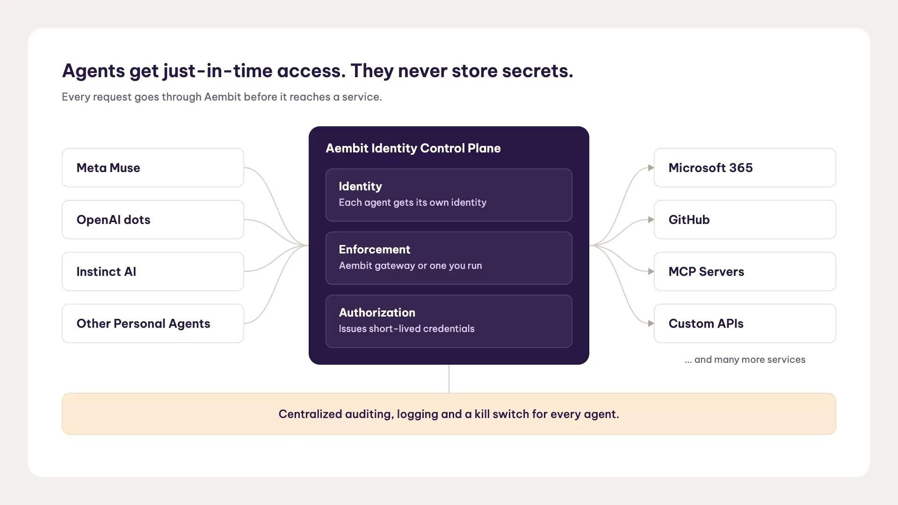

# Aembit 把访问控制延伸到“个人 AI 代理”

> 随着 Meta Muse、OpenAI Dots 这类个人 AI 代理进入职场，它们会借员工凭证接触邮箱、代码库和企业内部工具，带来难以察觉的数据泄露风险。Aembit 推出“混合身份”方案，给代理单独的身份并可随时吊销，而不必停掉员工账号。

个人 AI 代理进入企业，带来了新的身份难题。

## 个人代理正在进入企业

号称“AI 代理身份控制平面”的 Aembit 宣布，其产品现已支持保护个人代理对企业环境的访问，现有客户无需额外付费即可使用。

随着 Meta Muse、OpenAI Dots 这类个人代理进入职场，它们可以借员工的凭证和授权，接触邮箱、云应用、代码仓库、内部工具等服务。这带来了敏感数据暴露、未授权变更，以及难以与员工本人行为区分的操作风险。更棘手的是，这些凭证可能存放在个人代理平台上，游离于安全团队的直接管控之外。

## “混合身份”：代理的身份加上员工的授权

Aembit 的思路是“混合身份”：把代理自身的身份，与它所代表的员工身份结合起来。组织在访问发生的当下同时评估两者，为获批的请求签发短时效凭证、集中记录代理活动，并且可以在不关闭员工账号的前提下吊销代理。

“个人 AI 代理会进入企业，理由和当年个人设备一样：只要能帮人把活干完，人们就会用，”Aembit 联合创始人兼 CEO David Goldschlag 说。“好消息是，这恰恰是 Aembit 生来要解决的访问问题：给代理一个自己的身份，管住它能碰什么，然后在不把员工踢下线的前提下把它关掉。”

## 不换账号，也能一键关停

Aembit 还让企业在策略执行位置上有灵活性：它的架构可以走 Aembit MCP 身份网关，也可以对接环境中已有的其他网关和执行点。身份、授权策略和审计仍集中在 Aembit，每一次访问请求都能被动态评估，只授予该次交互所需的权限。

目前它已明确支持 Meta Muse，也覆盖 Microsoft Copilot Studio、Claude、ChatGPT、Gemini 以及基于自定义大模型的工作流。

