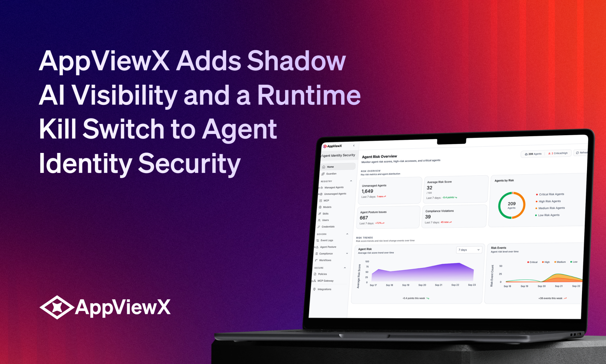

# AppViewX 给“代理身份安全”加上影子 AI 可见性与运行时急停开关

> 企业里的 AI 代理正在失控式增长。AppViewX 扩展了代理身份安全能力：发现每一个代理（无论合规还是“影子”）、实时监控它的每个动作、在运行时按下急停开关，并签发抗量子的代理身份，为后量子时代提前铺路。

代理身份安全，正在成为 CISO 的新战场。

## 代理失控带来的身份难题

AppViewX 扩展了其“代理身份安全”（Agent Identity Security）方案的能力：企业可以发现每一个代理——无论是被批准的，还是悄悄冒出来的“影子”；治理其安全态势、保留可供审计的活动日志；并实时监控和控制代理执行的每一个动作。它现在还能签发抗量子的代理身份，让企业对每个代理的信任，在企业密码学基础设施演进的过程中依然成立。

AI 代理的蔓延，正给首席信息安全官（CISO）制造新的身份挑战。每个代理都带来模型、凭证、权限、技能，以及与企业系统的连接，这些都必须被保护；而代理可以自主、或在人的名义下创建和行动，其速度和规模远超传统访问控制的设计初衷。

AppViewX 把代理安全当作身份与访问问题来处理，但认为需要一套新范式：它不是把传统的人类身份架构简单改造，而是在身份层专门为代理构建，覆盖编码代理、企业生产力代理、终端代理、SaaS 代理和自建代理。

## “治理”要趁早，还要能实时看得见

“‘治理’一旦等到代理和它们的访问权限扩散开来再引入，就会难上加难，”ZoomInfo 企业应用与 AI 副总裁 Venkat Chivukula 说。“随着代理连接更多系统、执行更多动作，组织需要一种方式去理解并控制它们的合并访问。代理身份安全帮我们把更大范围的生命周期治理、特权访问控制和运行时检测整合起来，好让我们在 AI 规模扩张的同时，及早立好护栏、持续保持控制。”

这套方案把发现、治理、运行时安全、检测与响应放在一起。正如 DocuSign 平台与服务高级总监 Sadeq Zabihi 所说：“我们需要扩张 AI，而且要快，但这要求同时解决底层的治理和风险问题。AppViewX 把发现、治理、安全、检测与响应聚合到一起，让我的团队能看清代理在哪里运作、施加正确的策略，并在它们的行为带来风险时及时发现。”

## 为后量子时代预埋信任

每个代理都是一个独特的身份类别，需要凭证去访问 API、工具和其他代理，其规模和速度是传统流程难以管理的。OAuth 规定了代理能代表用户做什么，但代理仍须证明“自己是谁”，而静态身份在代理规模下既容易被泄露、又难以管理。

AppViewX 扩展了核心的 PKI（公钥基础设施）和 CLM（证书生命周期管理）平台能力，用于签发可加密验证的抗量子代理身份，在通过企业身份提供商（IdP）认证时多添一层信任。由于这些身份链到客户由 AppViewX 托管的 PKI，安全团队获得一个可信根、一条清晰的防篡改审计链，以及一个集中构建抗量子代理身份的地方。

